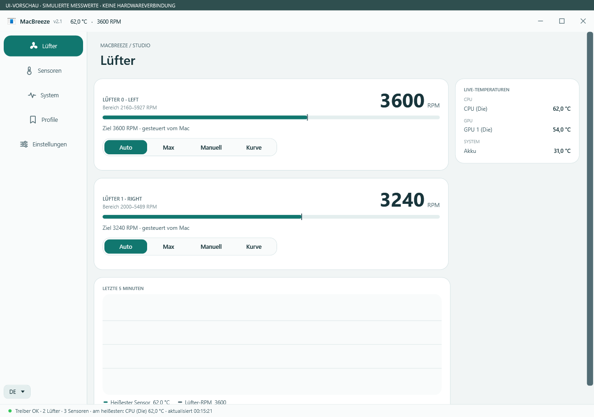
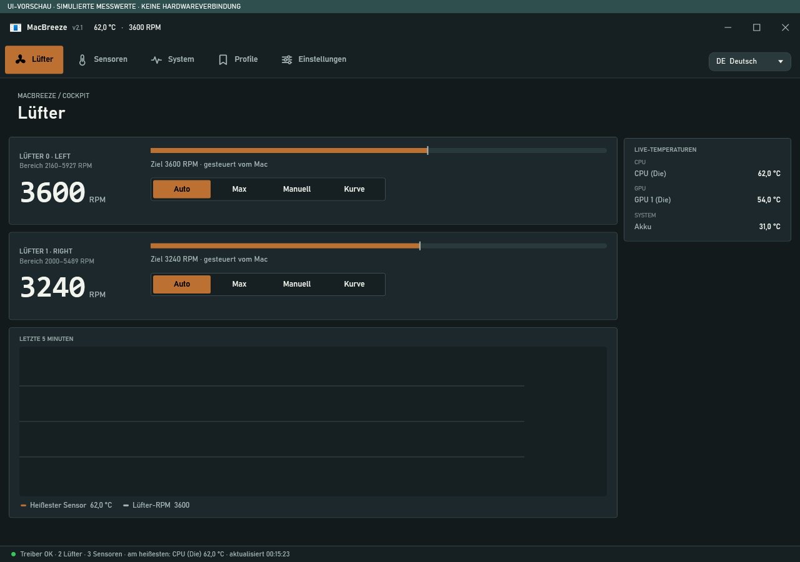
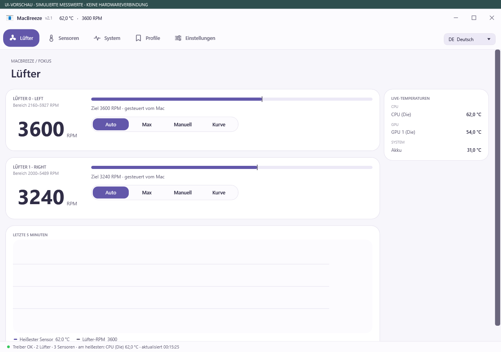
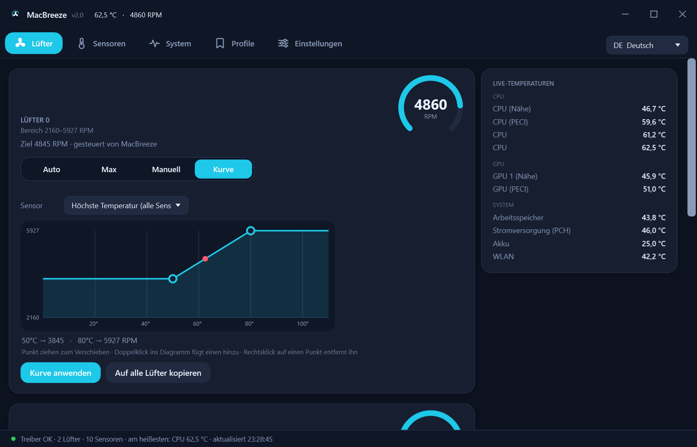
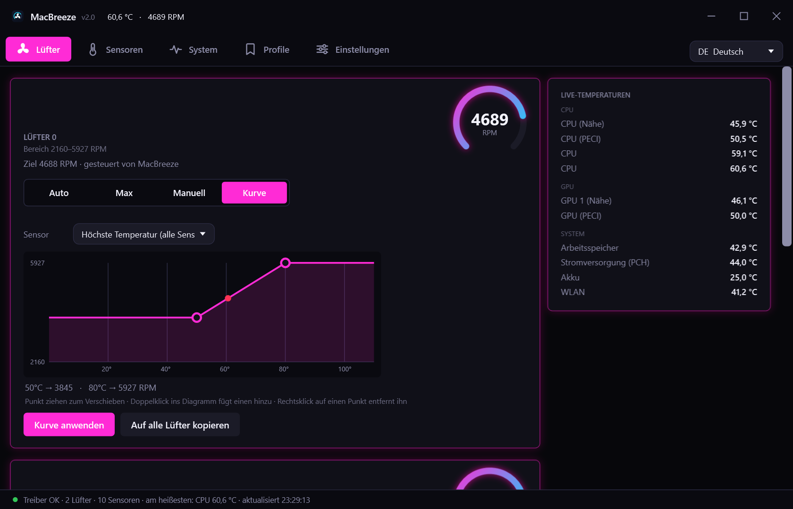
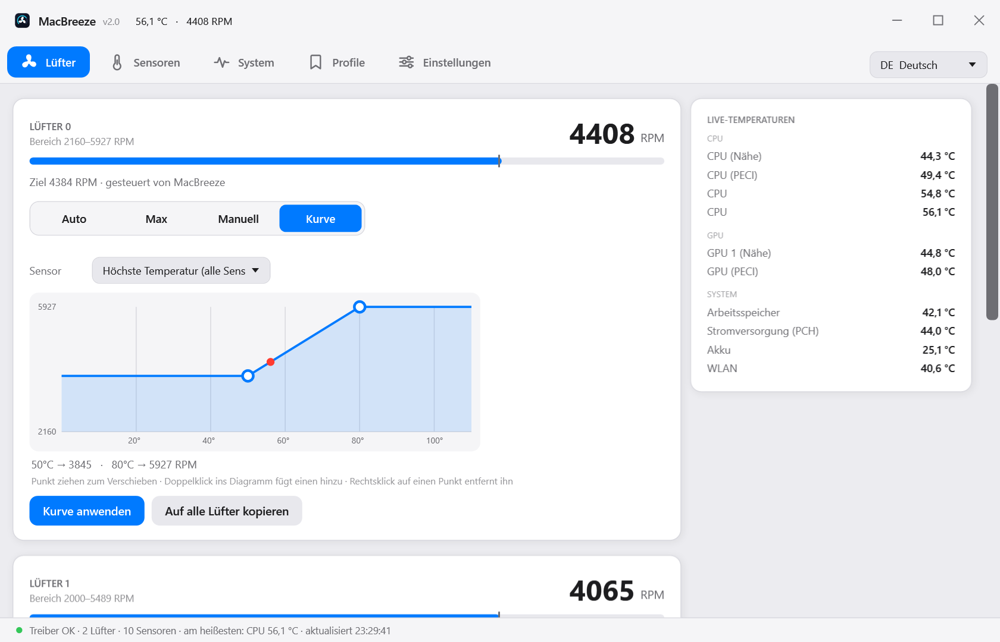
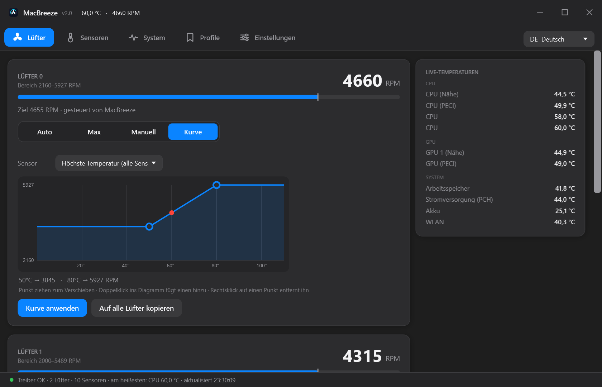
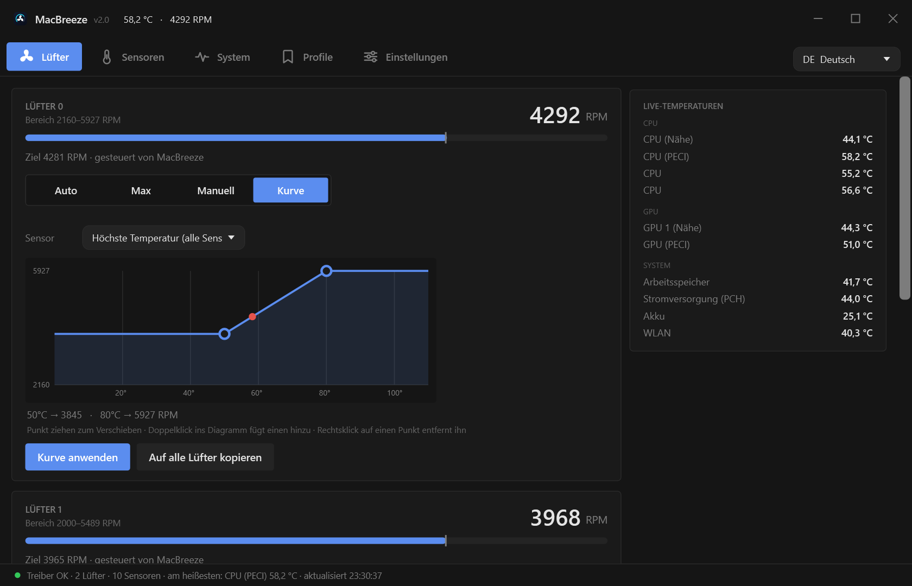

# MacBreeze 2.1

[Deutsch](README.md) · [English](README.en.md)

**Fan control and system monitoring for Intel Macs running Windows (Boot Camp).**

MacBreeze is based on [RPMac](https://github.com/golirt1/RPMAC) and adds a multilingual interface, five visual styles, a system monitor, and a quick information panel for the system tray icon.

[Download the Windows package](https://github.com/Dirtyx686/MacBreeze/releases/tag/v2.1.0) · [Installation guide (German)](docs/INSTALLATION.md) · [Screenshot gallery](docs/SCREENSHOTS.md) · [Build guide (German)](docs/BUILD.md)

## New in 2.1

Three additional layouts: **Studio**, **Cockpit**, and **Focus**. Choose an accent preset or enter a custom hex color; the choice is saved, and accent text adjusts for contrast. Existing hardware detection is retained, with an explicit confirmation before T2 driver and test-signing changes.

[Download the setup EXE](https://github.com/Dirtyx686/MacBreeze/releases/download/v2.1.0/MacBreeze-2.1-Setup.exe) · [2.1 verification (German)](docs/VERIFICATION-2.1.md)

The following native UI previews use simulated readings, with no connection to real fan hardware.

The five previous styles remain available. Studio uses left navigation; Cockpit and Focus use top navigation. Navigation position remains configurable for the previous styles.

## Features

| Area | Options |
|---|---|
| Fans | Auto, Max, fixed RPM, or a temperature curve for each fan; graphical curve editor |
| Sensors | Grouped temperature readings, raw SMC keys, and custom sensor names |
| System | CPU, memory, network, system drive, battery, and processes with high CPU usage |
| Profiles | Save fan settings and select them from the interface or system tray |
| Display | Five visual styles, resizable window, top or left navigation, overlay, and tray information panel |
| Language | 24 selectable interface languages; missing translations fall back to English |
| Recording | Log measurements to CSV |
| Temperature rules | Configurable emergency cooling and optional emergency shutdown |

These descriptions were checked against the source code and supplied screenshots. The Windows build was verified. This distribution was not tested again on Apple hardware; sensor availability and fan control depend on the model and driver. The temperature rules do not guarantee reliable protection against overheating.

## Installation and first launch

1. Download **MacBreeze-2.1-Windows.zip** from [Releases](https://github.com/Dirtyx686/MacBreeze/releases/tag/v2.1.0) and extract the entire archive into a permanent folder.
2. Keep all program files together, including `MacBreeze.exe.config`, `inpout32.dll`, `AppleT2Smc.bin`, `smccore.exe`, and `setup-pawnio-t2.ps1`.
3. Run `MacBreeze.exe` and approve the administrator prompt.
4. On its first launch, the app creates a desktop shortcut and scheduled tasks, and enables startup at Windows sign-in. You can disable this under **Settings → Start with Windows**.
5. Check the sensors, fan speeds, and driver status first. Set custom fan values only after this check.

The desktop shortcut uses a scheduled task with elevated privileges; the app still runs as administrator. Closing the window may leave the app running in the system tray. Use the tray icon's context menu to exit completely.

**Requirements:** An Intel Mac running Windows through Boot Camp, .NET Framework 4.x including WPF, and administrator privileges for hardware access. The programs are built for x86. Fan support is not promised for Apple Silicon or arbitrary Windows PCs.

**T2 Macs:** The included setup helper changes Windows test-signing settings and installs PawnIO 2.0.1 unrestricted. This reduces system security restrictions. It may uninstall an existing PawnIO driver and remove cached driver packages before installing the specified version, and a restart is required. Read the [T2 notes (German)](docs/INSTALLATION.md#t2-macs) before running it; the repair action makes system changes. The helper stops if Secure Boot is enabled.

## Usage

- **Auto:** Let the Mac control the fan. **Max:** Use the maximum speed reported by the SMC. **Manual:** Set and apply a target RPM.
- **Curve:** Select a sensor, drag points, double-click to add a point, or right-click to remove one; then select **Apply curve**.
- **Profiles:** Name and save a setting you have checked. A startup profile can be selected separately.
- **Sensors/System:** Observe readings and system load. Heat-related hints are heuristic estimates, not hardware diagnoses.
- **Settings:** Adjust the language, visual style, startup behavior, system tray, overlay, and temperature rules.

Settings and logs are stored in `%APPDATA%\MacBreeze`. Do not add them to the repository or share them in a bug report without checking their contents first.

## Five visual styles

| Modern dark | Gaming / RGB | macOS light | macOS dark | Minimal |
|---|---|---|---|---|
|  |  |  |  |  |

The [gallery](docs/SCREENSHOTS.md) contains 20 views from the supplied images. System views showing lists of running processes were excluded for privacy. Measurements in screenshots are snapshots. The supplied screenshots show the German interface.

## Development

On Windows, run `build.bat` from the project folder. The script compiles the GUI and command-line program, then copies the required runtime files and licenses into `build\`. Visual Studio is not required; the .NET Framework compiler and WPF libraries must be installed.

Further documentation is currently in German: [build instructions and project structure](docs/BUILD.md), [changes](CHANGELOG.md), and [verification scope for version 2.0](docs/VERIFICATION.md).

## License and attribution

MacBreeze is a modified version of RPMac by golirt1. The main code is licensed under **GPL-2.0-only**. Copyright and attribution notices are in [NOTICE](NOTICE); the full license text is in [LICENSE](LICENSE).

Individual components have separate terms: **InpOut32 (MIT)** and **AppleT2Smc (LGPL-2.1-or-later)**. Original license texts and sources are listed in [THIRD-PARTY.md](THIRD-PARTY.md). The setup helper downloads the PawnIO driver separately; the driver is not included in the Windows package.
