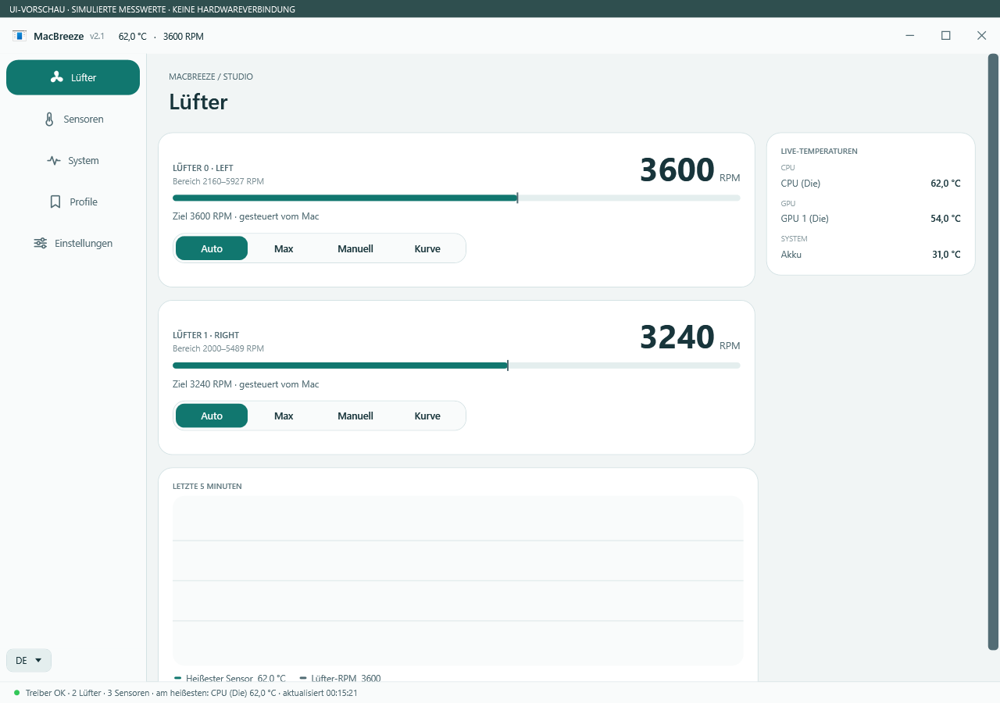
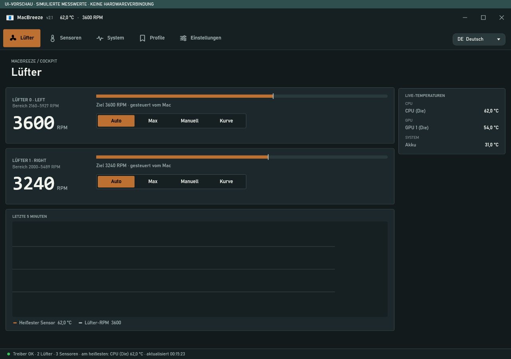
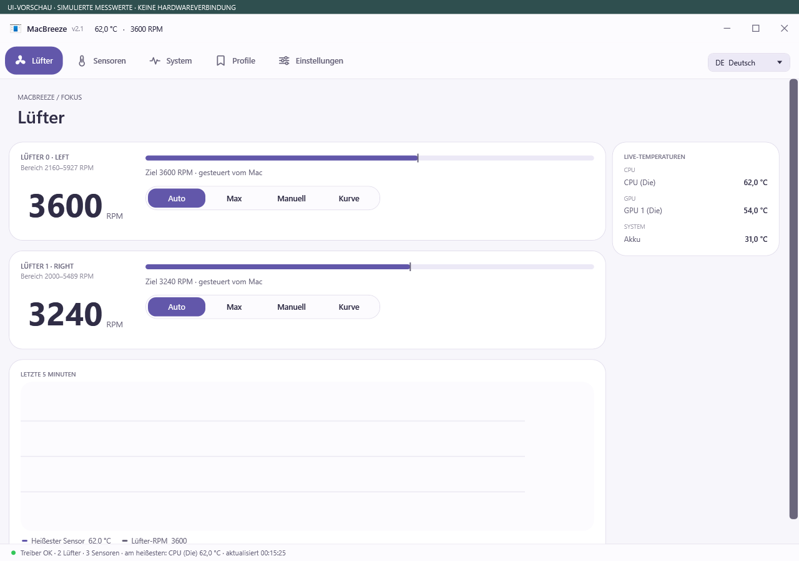
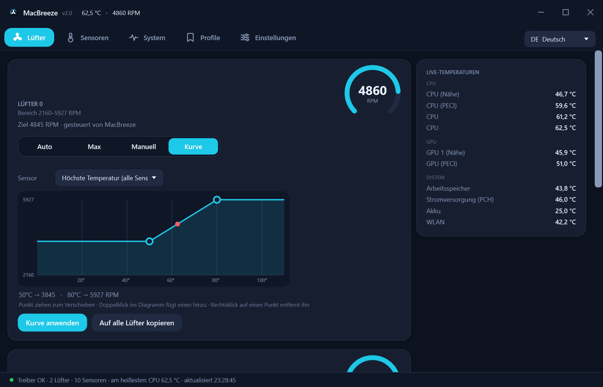
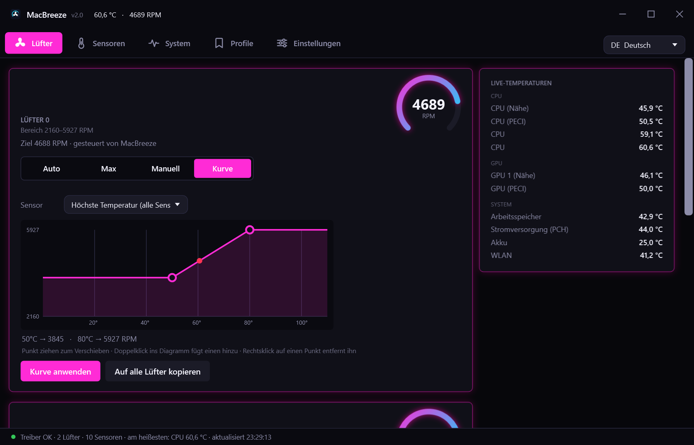
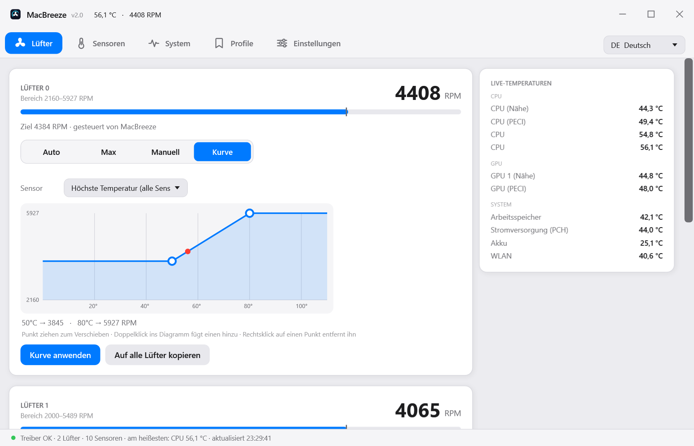
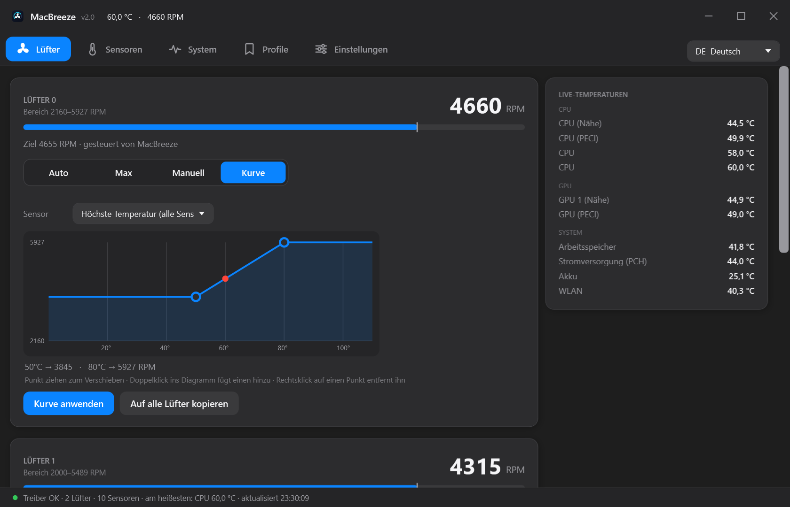
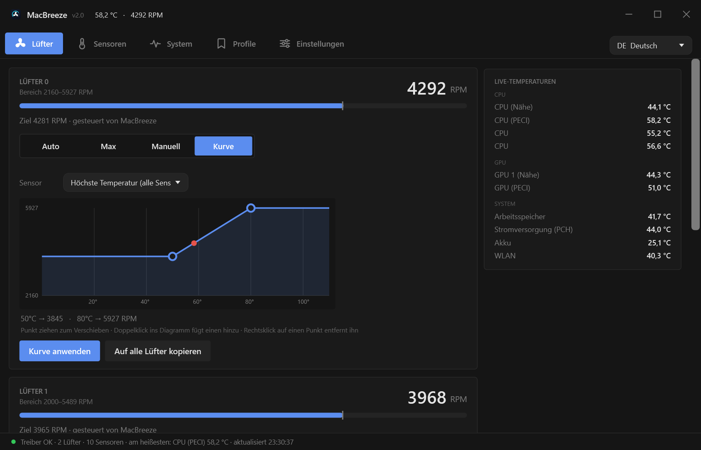

# MacBreeze 2.1

[Deutsch](README.md) · [English](README.en.md)

**Lüftersteuerung und Systemmonitor für Intel-Macs unter Windows (Boot Camp).**

MacBreeze basiert auf [RPMac](https://github.com/golirt1/RPMAC) und ergänzt eine mehrsprachige Oberfläche, fünf Erscheinungsbilder, einen Systemmonitor und eine Kurzinfo am Symbol im Infobereich.

[Windows-Paket herunterladen](https://github.com/Dirtyx686/MacBreeze/releases/tag/v2.1.0) · [Installationsanleitung](docs/INSTALLATION.md) · [Screenshot-Galerie](docs/SCREENSHOTS.md) · [Selbst bauen](docs/BUILD.md)

## Neu in 2.1

- **Studio:** breite Navigation und anpassbare Lüfterkarten.
- **Cockpit:** dunkle Instrumentenansicht mit seitlichen RPM-Anzeigen.
- **Fokus:** kompakte Zweispalten-Steuerung mit zentrierter Drehzahl.
- **Akzentfarbe:** sechs Vorschläge oder eigener Hexcode; wird gespeichert. Die Schrift auf Akzentflächen passt sich der Helligkeit an.
- **T2-Einrichtung:** vorhandene Hardwareerkennung, zusätzliche Ja/Nein-Abfrage vor Treiber- und Testsignaturänderungen.

[Setup-EXE herunterladen](https://github.com/Dirtyx686/MacBreeze/releases/download/v2.1.0/MacBreeze-2.1-Setup.exe) · [Prüfung für 2.1](docs/VERIFICATION-2.1.md)

### Neue Oberflächen – UI-Vorschau mit simulierten Werten

Die bisherigen fünf Looks bleiben zusätzlich verfügbar. Studio verwendet die Navigation links, Cockpit und Fokus oben; für die bisherigen Looks bleibt die Position frei wählbar.

## Funktionen

| Bereich | Möglichkeiten |
|---|---|
| Lüfter | Pro Lüfter Auto, Max, feste Drehzahl oder temperaturabhängige Kurve; grafischer Kurveneditor |
| Sensoren | Temperaturanzeigen nach Gruppen, rohe SMC-Schlüssel und eigene Sensornamen |
| System | CPU, Arbeitsspeicher, Netzwerk, Systemlaufwerk, Akku und Prozesse mit hoher CPU-Last |
| Profile | Lüftereinstellungen speichern und über die Oberfläche oder den Infobereich auswählen |
| Anzeige | Fünf Looks, veränderbare Fenstergröße, Menüleiste oben oder links, Overlay und Kurzinfo |
| Sprache | 24 auswählbare Oberflächensprachen; fehlende Übersetzungen fallen auf Englisch zurück |
| Aufzeichnung | Messwerte als CSV protokollieren |
| Temperaturregeln | Einstellbare Notkühlung und optionale Notabschaltung |

Diese Angaben wurden mit Quellcode und bereitgestellten Screenshots abgeglichen. Der Windows-Build wurde geprüft. Ein neuer Funktionstest an Apple-Hardware war nicht Teil dieser Bereitstellung; die Verfügbarkeit von Sensoren und Lüftersteuerung hängt von Modell und Treiber ab. Die Temperaturregeln sind keine Zusage eines zuverlässigen Überhitzungsschutzes.

## Installation und erster Start

1. Unter [Releases](https://github.com/Dirtyx686/MacBreeze/releases/tag/v2.1.0) das Paket **MacBreeze-2.1-Windows.zip** herunterladen und vollständig in einen dauerhaften Ordner entpacken.
2. Alle Programmdateien zusammenlassen, einschließlich `MacBreeze.exe.config`, `inpout32.dll`, `AppleT2Smc.bin`, `smccore.exe` und `setup-pawnio-t2.ps1`.
3. `MacBreeze.exe` starten und die Administratorabfrage bestätigen.
4. Beim ersten Start legt die App eine Desktop-Verknüpfung sowie geplante Aufgaben an und aktiviert den Start bei der Windows-Anmeldung. Den Autostart kannst du unter **Einstellungen → Mit Windows starten** abschalten.
5. Zunächst Sensoren, Drehzahlen und Treiberstatus prüfen. Individuelle Lüfterwerte erst nach dieser Kontrolle einstellen.

Die Desktop-Verknüpfung verwendet eine geplante Aufgabe mit erhöhten Rechten; die App arbeitet weiterhin als Administrator. Das Schließen des Fensters kann die App im Infobereich weiterlaufen lassen. Zum Beenden dort das Kontextmenü verwenden.

**Voraussetzungen:** Intel-Mac mit Windows/Boot Camp, .NET Framework 4.x einschließlich WPF und Administratorrechte für den Hardwarezugriff. Die Programme sind für x86 gebaut. Für Apple Silicon oder beliebige Windows-PCs wird keine Lüfterunterstützung zugesagt.

**T2-Macs:** Der beigefügte Einrichtungshelfer verändert die Windows-Testsignatur und installiert PawnIO 2.0.1 unrestricted. Das senkt Sicherheitsbeschränkungen des Systems. Vor dem Aufruf die [T2-Hinweise](docs/INSTALLATION.md#t2-macs) lesen; die Funktion ist kein gewöhnlicher Reparaturknopf ohne Systemänderungen.

## Bedienung

- **Auto:** Steuerung dem Mac überlassen. **Max:** maximale vom SMC gemeldete Drehzahl. **Manuell:** Zielwert einstellen und anwenden.
- **Kurve:** Sensor auswählen, Punkte verschieben, per Doppelklick ergänzen oder per Rechtsklick entfernen; anschließend **Kurve anwenden** wählen.
- **Profile:** Eine geprüfte Einstellung benennen und speichern. Ein Startprofil kann gesondert gewählt werden.
- **Sensoren/System:** Messwerte und Last beobachten. Hinweise zur Wärmeentwicklung sind heuristische Einschätzungen, keine Hardwarediagnose.
- **Einstellungen:** Sprache, Look, Autostart, Infobereich, Overlay und Temperaturregeln anpassen.

Einstellungen und Protokolle liegen in `%APPDATA%\MacBreeze`. Sie gehören nicht ins Repository oder in einen ungeprüften Fehlerbericht.

## Fünf Looks

| Modern dunkel | Gaming / RGB | macOS hell | macOS dunkel | Minimal |
|---|---|---|---|---|
|  |  |  |  |  |

Die [Galerie](docs/SCREENSHOTS.md) zeigt 20 Ansichten aus den bereitgestellten Bildern. Systemansichten mit sichtbaren Prozesslisten wurden aus Datenschutzgründen nicht übernommen. Messwerte in Bildern sind Momentaufnahmen.

## Entwicklung

Unter Windows im Projektordner `build.bat` ausführen. Das Skript kompiliert GUI und Kommandozeilenprogramm und kopiert die benötigten Laufzeitdateien und Lizenzen nach `build\`. Visual Studio wird dafür nicht benötigt; der .NET-Framework-Compiler und die WPF-Bibliotheken müssen installiert sein.

Weitere Informationen: [Build und Projektstruktur](docs/BUILD.md), [Änderungen](CHANGELOG.md), [Prüfumfang zur Version 2.0](docs/VERIFICATION.md).

## Lizenz und Herkunft

MacBreeze ist eine abgeleitete Version von RPMac von golirt1. Der Hauptcode steht unter **GPL-2.0-only**; Copyright- und Herkunftshinweise stehen in [NOTICE](NOTICE), der vollständige Lizenztext in [LICENSE](LICENSE).

Für einzelne Komponenten gelten eigene Bedingungen: **InpOut32 (MIT)** und **AppleT2Smc (LGPL-2.1-or-later)**. Die Originaltexte und Quellen sind in [THIRD-PARTY.md](THIRD-PARTY.md) aufgeführt. Der PawnIO-Treiber wird vom Einrichtungshelfer separat heruntergeladen und ist nicht im Windows-Paket enthalten.
