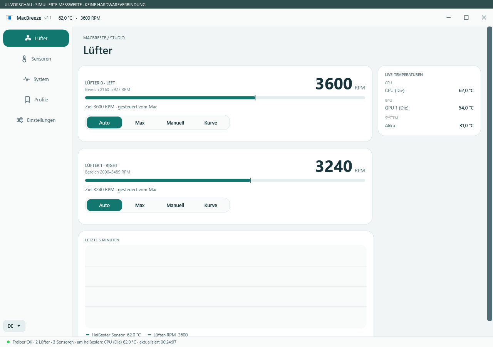
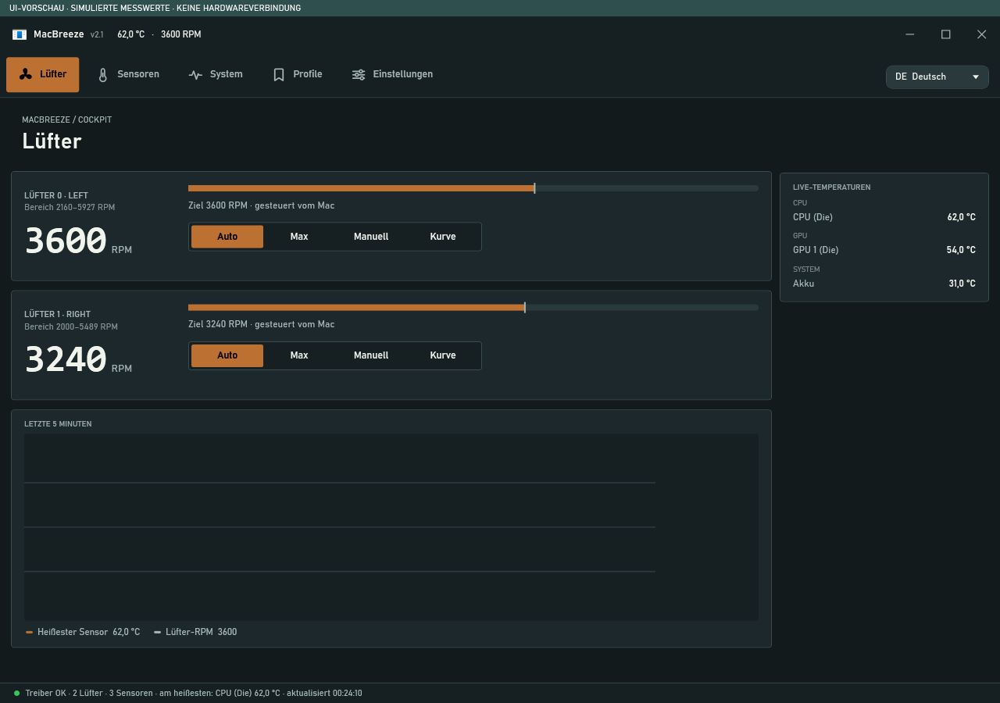
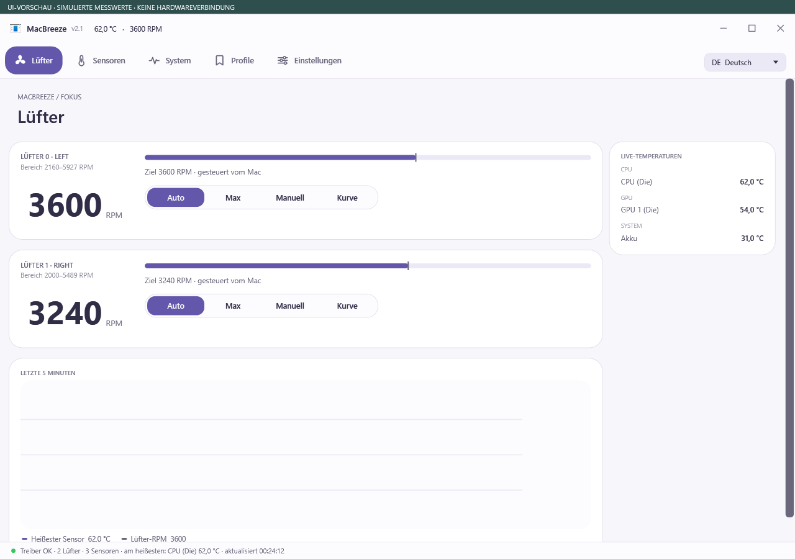
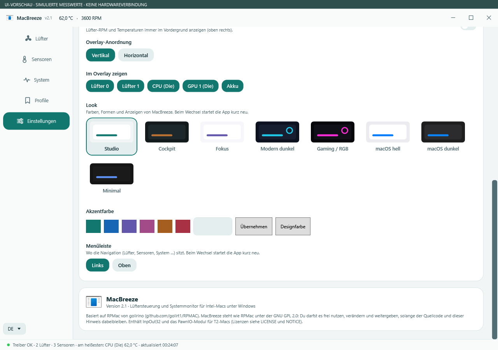

# MacBreeze 2.1 – aktuelle Oberflächen

Die drei neuen Designs sind **Studio**, **Cockpit** und **Fokus**. Zusätzlich sind die fünf klassischen Looks weiterhin auswählbar: **acht Looks insgesamt**. Die Akzentfarbe lässt sich unabhängig vom Look auswählen.

Die folgenden Bilder zeigen die native App aus Version 2.1, keine Designentwürfe. Die Messwerte stammen aus einer isolierten Simulation ohne Hardwareverbindung; jedes Bild trägt einen entsprechenden Hinweis.

## Studio

Navigation links, helle Karten und großzügige Drehzahlanzeigen.

## Cockpit

Dunkle Instrumentenansicht mit seitlicher Drehzahl und kantigen Flächen.

## Fokus

Kompakte Steuerung mit zentrierter Drehzahl und Reglern daneben.

## Look auswählen und Farbe ändern

Unter **Einstellungen → Look** stehen die drei neuen und die fünf klassischen Looks. Unter **Akzentfarbe** einen Vorschlag auswählen oder einen Hexcode wie `#11776F` eingeben und **Übernehmen** wählen. **Designfarbe** setzt den Akzent auf den Standard des jeweiligen Looks zurück. Die Auswahl bleibt nach dem Neustart erhalten.

## Ältere Bilder

Die ursprünglichen 20 Aufnahmen der fünf klassischen Looks stehen getrennt im [Screenshot-Archiv zu Version 2.0](archive/SCREENSHOTS-2.0.md). Sie stellen nicht die neuen Designs dar.
